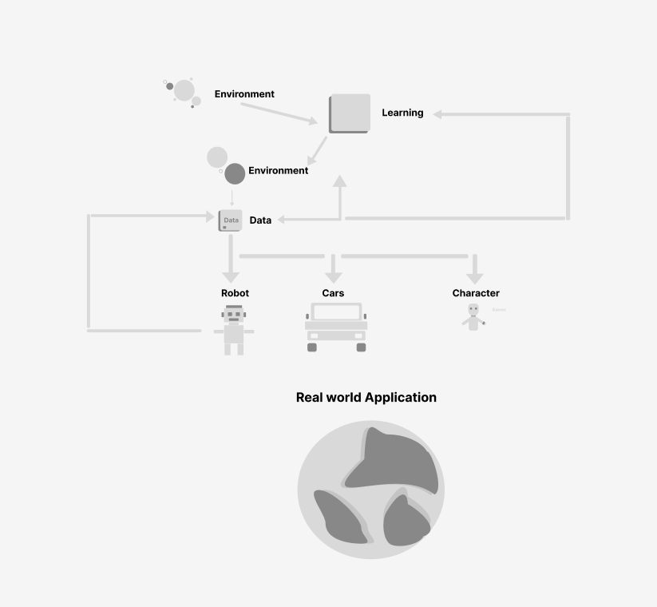

# Universe Agent System

The Universe Agent System (UAS) is a concept for an adaptive artificial intelligence framework in which multiple agents learn inside different simulated environments and contribute their experiences to a shared memory system. A central AI can retrieve and combine that knowledge to respond to unfamiliar scenarios.

> **Project status:** Research concept and early design documentation. The repository does not yet contain a runnable implementation.

## How it works

1. Multiple agents explore distinct virtual environments and learn through interaction.
2. Each agent sends useful experiences to a centralized memory repository.
3. A scenario-matching engine retrieves relevant knowledge for new tasks.
4. Agents and the central AI continuously exchange feedback and improve their behavior.
5. Knowledge developed in simulation can eventually be transferred to real-world systems.

## Proposed components

- **Multi-agent framework** — assigns goals, runs agents in parallel environments, and supports knowledge transfer between agents.
- **Centralized memory** — stores experiences using embeddings, knowledge graphs, and memory networks.
- **Scenario matching** — finds relevant prior experiences with similarity search and predictive models.
- **Continuous learning loop** — updates agents and shared memory as new experiences arrive.
- **Environment generation** — creates and evolves training environments from descriptive inputs.
- **Movement learning** — analyzes and reproduces human or machine movement while accounting for physical constraints.

## Potential applications

- Adaptive game characters and dynamic storytelling
- Robots that transfer knowledge across tasks and environments
- Autonomous-system simulation and edge-case training
- Interactive creative tools and personalized media

## Proposed technology stack

| Area | Candidate tools |
| --- | --- |
| Reinforcement learning | Stable-Baselines3, Ray RLlib |
| Simulation | Gymnasium/OpenAI Gym, Unity ML-Agents, PyBullet |
| Knowledge storage | SQLite, Neo4j, Elasticsearch |
| Memory representation | Sentence Transformers, NumPy, knowledge graphs |
| Movement analysis | MediaPipe, OpenPose |
| Visualization | TensorBoard, Matplotlib |

## Roadmap

- Define a minimal agent and environment interface.
- Build a small shared-memory prototype with semantic retrieval.
- Demonstrate knowledge transfer between two simulated agents.
- Add evaluation metrics for transfer quality, adaptability, and memory relevance.
- Explore procedural environment generation and simulation-to-reality transfer.

## Project documents

- [Research landscape and supporting evidence](docs/RESEARCH_LANDSCAPE.md) — related projects, papers, benchmarks, and tools organized around the UAS concept.
- [How existing research fits UAS](docs/RESEARCH_TO_UAS_MAP.md) — maps prior work to each proposed UAS component, separates established evidence from open hypotheses, and defines a focused first experiment.
- [Project description](Project%20Description%20Universe%20Agent%20System%20%28UAS%29%2016e3df2ced6d8028aaceed7a9f4923e9.md)
- [Initial case study](Universe%20Agent%20System%2016e3df2ced6d80e49c50f6e40b90df82.md)
- [Expanded case study](Universe%20Agent%20System%201963df2ced6d80cca9a3de1f01471efe.md)

## Contributing

Ideas, architecture proposals, experiments, and prototype implementations are welcome. Open an issue to discuss a substantial change before beginning work.

## License

No license has been selected yet. The contents are publicly viewable, but reuse rights remain reserved until a license is added.
