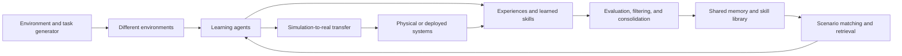

# Research Landscape and Supporting Evidence

_Last reviewed: October 11, 2026_

This page explains the Universe Agent System (UAS), connects each part of the concept to established research, and identifies projects, papers, benchmarks, and open-source tools that explore related problems.

The field is broad and changes quickly, so this is a curated map of the closest and most useful work rather than a claim of complete coverage. Links point to original papers, official project pages, or official documentation whenever possible.

## The main idea

UAS proposes a network of learning agents operating in different environments. Each agent collects experience, identifies useful knowledge or skills, and contributes them to shared memory. When an agent encounters a new situation, it retrieves relevant prior experience instead of always learning from the beginning. A continual feedback loop evaluates outcomes, improves the shared knowledge, and makes it available to the rest of the system.

The larger vision also includes automatically generated training environments, learning movement from demonstrations, and transferring abilities from simulation to physical systems.

In research terms, UAS combines:

| UAS component | Related research area | Central question |
| --- | --- | --- |
| Agents exploring different worlds | Multi-task and multi-agent reinforcement learning | Can experience across tasks improve learning and generalization? |
| Central memory | Episodic memory, semantic memory, replay, retrieval, and knowledge graphs | What should be stored, consolidated, retrieved, updated, or forgotten? |
| Scenario matching | Transfer learning, meta-learning, retrieval, and skill selection | Which past experience or skill applies to the current situation? |
| Continuous updates | Continual and lifelong learning | Can new abilities be acquired without destroying older ones? |
| Generated environments | Open-ended learning, automated curricula, and world models | Can the system generate useful challenges at the agent's learning frontier? |
| Real-world application | Embodied AI and simulation-to-real transfer | Which learned behaviors remain reliable under real physical conditions? |
| Movement learning | Imitation learning and physics-based character control | Can demonstrations become robust, reusable motor skills? |

## Closely related generalist and multi-world agents

These systems are the closest precedents for agents that learn across tasks, worlds, or embodiments.

| Project | What it demonstrates | Relationship to UAS |
| --- | --- | --- |
| [Gato](https://deepmind.google/blog/a-generalist-agent/) (2022) | One transformer policy can process multiple modalities and act across Atari, simulated control, language, vision, and a real robot arm. | Supports the possibility of a common agent model spanning different tasks and embodiments. |
| [XLand / Open-Ended Learning](https://deepmind.google/blog/generally-capable-agents-emerge-from-open-ended-play/) (2021) | Agents trained over procedurally generated multiplayer games developed general behaviors and zero-shot performance on held-out tasks. | Closely relates to UAS's universe of environments, automated task creation, and cross-task adaptation. |
| [AdA: Human-Timescale Adaptation in an Open-Ended Task Space](https://arxiv.org/abs/2301.07608) (2023) | A meta-RL agent adapts rapidly to unseen embodied 3D tasks using memory, diverse training, and an automated curriculum. | Supports fast adaptation, memory-based behavior, and training across a large task distribution. |
| [SIMA](https://deepmind.google/blog/sima-generalist-ai-agent-for-3d-virtual-environments/) (2024) | A generalist agent follows language instructions through screen perception and ordinary keyboard/mouse actions across multiple 3D games. | Directly relates to operating across different virtual environments through a common interface. |
| [SIMA 2](https://deepmind.google/blog/sima-2-an-agent-that-plays-reasons-and-learns-with-you-in-virtual-3d-worlds/) (2025) | A Gemini-powered successor reasons about goals, generalizes to held-out games, and improves from self-generated experience. | Closely aligns with multi-world adaptation, self-improvement, and reusable experience. Its reported short interaction memory also highlights an open UAS problem. |
| [MineDojo](https://minedojo.org/) (2022) | An open Minecraft framework with thousands of language-prompted tasks and large video, wiki, and discussion datasets. | Provides an open-ended environment and knowledge base for testing continual embodied learning. |
| [Voyager](https://arxiv.org/abs/2305.16291) (2023) | A Minecraft agent uses an automatic curriculum, feedback, self-verification, and a growing library of executable skills. | A strong example of storing reusable behaviors rather than only raw observations. |
| [DreamerV3](https://arxiv.org/abs/2301.04104) (2023) | A world-model agent learns across more than 150 tasks with one configuration and plans by imagining future outcomes. | Supports reusable learning machinery across domains and model-based planning. |
| [RoboCat](https://deepmind.google/blog/robocat-a-self-improving-robotic-agent) (2023) | A generalist robot agent learns tasks across different arms and generates additional training data to improve itself. | Relates to cross-embodiment transfer and a self-improving data loop. |

### What this body of work supports

- Training across diverse tasks can produce behavior that transfers beyond a single task.
- A common observation/action interface makes cross-environment learning easier to formulate.
- Automated curricula and reusable skills can reduce repeated learning.
- Generalization is still bounded by the training distribution, interface, memory, and evaluation regime; these systems do not establish adaptation to every possible environment.

## Shared experience and multi-agent knowledge transfer

UAS assumes that knowledge learned by one agent can benefit other agents. Research supports that possibility, but it also shows that transfer must be selective because unrelated tasks can interfere with one another.

| Work | Contribution | Relevance to UAS |
| --- | --- | --- |
| [Distral: Robust Multitask Reinforcement Learning](https://arxiv.org/abs/1707.04175) (2017) | Task-specific workers contribute to and learn from a shared distilled policy while avoiding direct parameter sharing. | An early architecture for a central source of reusable behavior. |
| [IMPALA](https://arxiv.org/abs/1802.01561) (2018) | Separates many distributed actors from centralized learners and demonstrates positive transfer across multi-task benchmarks. | Provides a scalable actor-learner pattern related to UAS's distributed agents and central learning process. |
| [Shared Experience Actor-Critic](https://arxiv.org/abs/2006.07169) (2020) | Agents reuse one another's experience to improve exploration and learning in sparse-reward environments. | Direct evidence that carefully corrected experience sharing can improve multi-agent learning. |
| [Parallel Knowledge Transfer in MARL](https://arxiv.org/abs/2003.13085) (2020) | Agents use attention to decide when to learn from other agents' behavior. | Supports selective rather than unconditional knowledge transfer. |
| [Centralized Reward Agent](https://papers.nips.cc/paper_files/paper/2025/hash/eeb273b238606e9186452bed7190a8ab-Abstract-Conference.html) (NeurIPS 2025) | A centralized reward agent distills knowledge from multiple tasks and redistributes useful reward signals to policy agents. | A recent example of a central knowledge pool serving distributed agents. |
| [Bi-Level Knowledge Transfer](https://papers.nips.cc/paper_files/paper/2025/hash/b7a55b1fa8f2500299e1af3562a1191d-Abstract-Conference.html) (NeurIPS 2025) | Transfers both individual skills and team-level tactics to unseen multi-agent tasks. | Shows that reusable knowledge can exist at both agent and group levels. |
| [MindForge / CollabVoyager](https://arxiv.org/abs/2411.12977) (2024) | Minecraft agents maintain semantic and episodic memories of collaboration and transfer knowledge from experienced agents to novices. | Particularly close to UAS's cross-agent experience and memory-sharing concept. |
| [AgentNet](https://papers.nips.cc/paper_files/paper/2025/hash/9a379c1b05793d1c42dc832269834515-Abstract-Conference.html) (NeurIPS 2025) | Agents dynamically specialize, change communication topology, and refine skills using retrieval-based memory. | Relates to evolving agent roles and decentralized alternatives to a single central controller. |

Multi-agent systems do not automatically outperform a well-designed single agent. [Why Do Multi-Agent LLM Systems Fail?](https://arxiv.org/abs/2503.13657) identifies failures involving specification, inter-agent alignment, verification, and termination. A UAS implementation therefore needs single-agent baselines, communication-cost measurements, and tests showing that shared knowledge produces a real benefit.

## Memory, retrieval, reflection, and knowledge graphs

Shared memory is more than a database. An effective system needs policies for writing, validating, linking, retrieving, consolidating, correcting, and forgetting information.

| Project or paper | Memory mechanism | Relevance to UAS |
| --- | --- | --- |
| [Differentiable Neural Computer](https://deepmind.google/blog/differentiable-neural-computers/) (2016) | A neural controller learns how to read from and write to external, linked memory. | A foundational example of combining learned control with structured external memory. |
| [Generative Agents](https://arxiv.org/abs/2304.03442) (2023) | Agents record observations, retrieve memories by relevance, and synthesize higher-level reflections for planning. | Demonstrates the observation-memory-reflection-planning loop proposed in UAS. |
| [Reflexion](https://arxiv.org/abs/2303.11366) (2023) | Verbal feedback and self-reflection are stored in episodic memory to improve later attempts without updating model weights. | Shows how outcomes can be converted into reusable lessons. |
| [MemGPT](https://arxiv.org/abs/2310.08560) (2023) | Manages multiple memory tiers to extend an agent beyond a model's immediate context window. | Supports hierarchical memory and explicit memory-management operations. |
| [A-MEM](https://arxiv.org/abs/2502.12110) (2025) | New memories receive structured attributes and dynamic links to related memories; existing memory representations can evolve. | Closely supports context-aware, interconnected, evolving memory. |
| [HippoRAG](https://arxiv.org/abs/2405.14831) (2024) | Combines language models, knowledge graphs, and graph traversal for associative long-term retrieval. | Supports the proposed hybrid of embeddings and graph-structured knowledge. |
| [Microsoft GraphRAG](https://www.microsoft.com/en-us/research/project/graphrag/) | Builds graph representations and hierarchical summaries to answer local and global questions over a collection. | Offers practical patterns for graph-based retrieval, although it is primarily a document-retrieval system rather than a learning agent. |
| [Voyager](https://arxiv.org/abs/2305.16291) (2023) | Stores executable, compositional skills and retrieves them for new Minecraft tasks. | Demonstrates that procedural or skill memory can be more actionable than storing raw episodes alone. |

Useful surveys and roadmaps include:

- [A Survey on the Memory Mechanism of Large Language Model Based Agents](https://arxiv.org/abs/2404.13501) (2024)
- [Lifelong Learning of Large Language Model Based Agents: A Roadmap](https://arxiv.org/abs/2501.07278) (2025)
- [Memory for Autonomous LLM Agents: Mechanisms, Evaluation, and Emerging Frontiers](https://arxiv.org/abs/2603.07670) (2026)
- [Survey on Evaluation of LLM-Based Agents](https://arxiv.org/abs/2503.16416) (2025)

Together, this research suggests that a UAS memory should distinguish at least:

1. **Episodic memory:** what happened during a specific attempt.
2. **Semantic memory:** stable facts and relationships learned across attempts.
3. **Procedural memory:** reusable policies, plans, tools, or skills.
4. **Working memory:** the limited context required for the current decision.

Each stored item should include its source, task and environment context, timestamp, outcome, confidence, compatibility constraints, and version. Similarity alone is not enough to decide that an experience is safe or useful.

## Continual and lifelong learning

Continual learning asks an agent to learn a sequence of tasks while retaining earlier abilities. The central risk is catastrophic forgetting: improvement on new tasks can degrade prior skills.

| Work | Contribution | UAS connection |
| --- | --- | --- |
| [CORA](https://proceedings.mlr.press/v199/powers22b.html) (CoLLAs 2022) | Open benchmarks, baselines, and metrics for forgetting, plasticity, generalization, and zero-shot forward transfer. | Supplies evaluation concepts for the UAS continuous-learning loop. |
| [Continual-Dreamer](https://proceedings.mlr.press/v232/kessler23a.html) (CoLLAs 2023) | Studies selective replay with world models for task-agnostic continual RL. | Supports experience selection and replay rather than preserving every event equally. |
| [Continual RL by Planning with Online World Models](https://proceedings.mlr.press/v267/liu25p.html) (ICML 2025) | Uses an incrementally updated world model and planning to acquire tasks without forgetting earlier ones under its studied setting. | Offers an alternative to repeatedly retraining a single policy. |
| [MEAL](https://proceedings.mlr.press/v306/tomilin26a.html) (ICML 2026) | A benchmark for continual multi-agent RL with long sequences of tasks and practical accelerated evaluation. | Directly joins UAS's continual-learning and multi-agent concerns. |

A UAS experiment should report at least task success, learning speed, backward transfer, forward transfer, isolated forgetting, memory/retrieval cost, and performance on held-out environments.

## Environment generation, curricula, and world models

UAS proposes environments that are created or adapted in response to agent behavior. This connects to both procedural environment design and generative world models.

| Project or paper | Contribution | UAS connection |
| --- | --- | --- |
| [POET](https://arxiv.org/abs/1901.01753) (2019) | Co-evolves environmental challenges and the agents that solve them, transferring solutions between environments. | A direct precedent for generating environments and moving useful solutions across them. |
| [PAIRED](https://arxiv.org/abs/2012.02096) (2020) | Uses regret to generate structured, solvable environments near the learner's frontier. | Provides a concrete objective for adaptive environment generation. |
| [XLand](https://deepmind.google/blog/generally-capable-agents-emerge-from-open-ended-play/) (2021) | Combines procedurally generated worlds, games, co-players, dynamic curricula, and population-based training. | Demonstrates a large-scale version of a changing universe of training tasks. |
| [Genie](https://deepmind.google/research/publications/60474/) (2024) | Learns action-controllable interactive environments from unlabeled video. | Supports environment generation from visual data rather than only handcrafted simulators. |
| [Genie 2](https://deepmind.google/blog/genie-2-a-large-scale-foundation-world-model/) (2024) | Generates playable 3D environments that can be used to test embodied agents. | Relates directly to rapidly creating new evaluation worlds. |
| [Genie 3](https://deepmind.google/models/genie/) (2025) | Generates promptable, real-time interactive worlds with improved short-horizon consistency. | Closely resembles descriptive environment generation, while its limited action space, duration, and multi-agent interaction remain important constraints. |
| [DreamerV3](https://arxiv.org/abs/2301.04104) (2023) | Learns an internal world model and trains behavior using imagined futures. | Represents internal predictive simulation rather than an external world generator. |

These approaches should not be treated as interchangeable. Procedural generation produces explicit simulator states and rules; learned world models generate or predict observations and dynamics; curricula decide which tasks to present. A practical UAS prototype can begin with procedural tasks and add learned generation later.

## Embodied AI, movement learning, and simulation-to-real transfer

The physical-world part of UAS has substantial supporting research, but real deployment requires safety engineering, real-world evaluation, and hardware-specific adaptation.

| Project or paper | Contribution | UAS connection |
| --- | --- | --- |
| [Domain Randomization](https://arxiv.org/abs/1703.06907) (2017) | Randomizes simulated appearance so perception models transfer more robustly to real observations. | A foundational method for addressing the simulation-to-real gap. |
| [OpenAI Dactyl / Learning Dexterity](https://openai.com/index/learning-dexterity/) (2018) | Trains a manipulation policy in randomized simulation and transfers it to a physical robot hand. | Demonstrates a scoped version of simulation-to-real behavior transfer. |
| [DeepMimic](https://arxiv.org/abs/1804.02717) (2018) | Learns robust physics-based character skills from example motion clips. | Supports learning natural movement from demonstrations while retaining task control. |
| [Adversarial Motion Priors](https://arxiv.org/abs/2104.02180) (2021) | Learns a reusable motion style prior from unstructured motion clips for physics-based control. | Relates to a shared movement representation that can support multiple tasks. |
| [Open X-Embodiment and RT-X](https://robotics-transformer-x.github.io/) (2023) | Aggregates data from many robot types and trains cross-embodiment policies that show positive transfer. | Direct evidence for learning across different physical embodiments. |
| [Gemini Robotics](https://deepmind.google/models/gemini-robotics/) | Combines vision-language-action control with embodied reasoning for planning and physical interaction across robot forms. | Represents the modern foundation-model approach to generalist physical agents. |
| [GR00T N1](https://research.nvidia.com/publication/2025-03_nvidia-isaac-gr00t-n1-open-foundation-model-humanoid-robots) (2025) | Trains a generalist humanoid policy with human video, real robot trajectories, simulated trajectories, and synthetic data. | Closely relates to combining several experience sources for transferable robot behavior. |
| [GR00T N1.6](https://research.nvidia.com/labs/gear/gr00t-n1_6/) (2025) | Extends the GR00T line with stronger real-robot, long-horizon, dexterity, and multi-task experiments. | Shows current progress while noting that robust language-conditioned generalization remains open. |

Simulation-to-real transfer should therefore be described as an experimental pipeline, not an automatic consequence of simulation. Domain randomization, system identification, real demonstrations, uncertainty estimates, safety constraints, and physical validation may all be required.

## Open tools and benchmarks for an affordable prototype

The complete industrial-scale vision is expensive, but the central research question can be tested using open environments and modest hardware.

| Resource | Purpose |
| --- | --- |
| [Gymnasium](https://gymnasium.farama.org/) | Standard API and reference environments for single-agent reinforcement learning. It is the maintained successor to OpenAI Gym. |
| [PettingZoo](https://pettingzoo.farama.org/) | Standard interfaces and environments for multi-agent reinforcement learning. |
| [RLlib multi-agent environments](https://docs.ray.io/en/latest/rllib/multi-agent-envs.html) | Distributed training and multi-agent environment support, including PettingZoo integration. |
| [Unity ML-Agents](https://github.com/Unity-Technologies/ml-agents) | Open toolkit for building visual, physics-based, cooperative, and competitive learning environments in Unity. |
| [Crafter](https://github.com/danijar/crafter) | Lightweight open-world benchmark for exploration, generalization, representation learning, and long-horizon reasoning. |
| [MineDojo](https://minedojo.org/) | Large Minecraft task suite for open-ended embodied-agent research. |
| [CORA](https://proceedings.mlr.press/v199/powers22b.html) | Continual-RL benchmarks and evaluation metrics. |
| [MEAL](https://proceedings.mlr.press/v306/tomilin26a.html) | Continual multi-agent RL benchmark designed to run long task sequences efficiently. |
| [Meta-World+](https://papers.nips.cc/paper_files/paper/2025/hash/da295a7037612bb3bfc1334a6f8fc8bd-Abstract-Datasets_and_Benchmarks_Track.html) | Standardized multi-task and meta-RL robot-manipulation benchmark. |
| [Isaac Lab](https://isaac-sim.github.io/IsaacLab/main/index.html) | Open robot-learning framework for simulation, demonstrations, reinforcement learning, motion planning, and domain randomization; it generally requires stronger hardware than grid-world experiments. |

## What remains distinct and testable in UAS

The individual ingredients are established research areas. A useful UAS contribution would come from a precise combination and a controlled demonstration, not from claiming that each ingredient is new.

One focused research question is:

> Can a governed shared memory of validated episodes and reusable skills improve zero-shot task success and sample efficiency across related environments compared with independent learning and naive shared replay?

A credible first experiment could compare:

1. Independent agents with no shared memory.
2. Agents that share every trajectory through a replay buffer.
3. Agents that retrieve experiences only by vector similarity.
4. Agents using structured memory with task metadata, provenance, outcome scores, deduplication, and compatibility filtering.
5. Agents using both structured episodic memory and a library of distilled skills.

Evaluation should use training environments plus held-out variations. Results should report multiple random seeds and include unsuccessful or negative-transfer cases.

## Important research limitations

The supporting work does not justify a claim that a system can immediately handle any environment without additional data or adaptation. The evidence instead supports narrower claims:

- Transfer is strongest between tasks with compatible observations, actions, dynamics, or skills.
- Retrieved information can be irrelevant, outdated, contradictory, unsafe, or malicious.
- New training can cause catastrophic forgetting or negative transfer.
- Multiple agents add coordination and communication costs.
- Generated environments may be visually convincing without being physically or causally reliable.
- Simulation-to-real success is task-specific and requires real-world testing.
- A percentage such as “99% natural behavior” has no meaning without a defined dataset, metric, baseline, and evaluation protocol.

For these reasons, the defensible near-term goal of UAS is not universal intelligence. It is a reproducible test of whether governed cross-agent memory and skill transfer improve adaptation in a clearly defined family of environments.

## Suggested reading path

For a compact introduction, read these in order:

1. [XLand](https://deepmind.google/blog/generally-capable-agents-emerge-from-open-ended-play/) for diverse tasks and open-ended curricula.
2. [Shared Experience Actor-Critic](https://arxiv.org/abs/2006.07169) for direct experience sharing between agents.
3. [Generative Agents](https://arxiv.org/abs/2304.03442) for retrieval and reflection over episodic memory.
4. [Voyager](https://arxiv.org/abs/2305.16291) for a persistent library of reusable embodied skills.
5. [CORA](https://proceedings.mlr.press/v199/powers22b.html) for continual-learning evaluation.
6. [SIMA 2](https://deepmind.google/blog/sima-2-an-agent-that-plays-reasons-and-learns-with-you-in-virtual-3d-worlds/) for current multi-world generalist agents and their limitations.
7. [MEAL](https://proceedings.mlr.press/v306/tomilin26a.html) for current continual multi-agent evaluation.
8. [Open X-Embodiment](https://robotics-transformer-x.github.io/) for cross-robot data and transfer.

## Scope note

The systems listed here overlap with portions of UAS but use different objectives, architectures, datasets, scales, and evaluation methods. Their inclusion provides technical context and supporting evidence; it does not imply that UAS is equivalent to, derived from, affiliated with, or validated by any listed project or organization.
