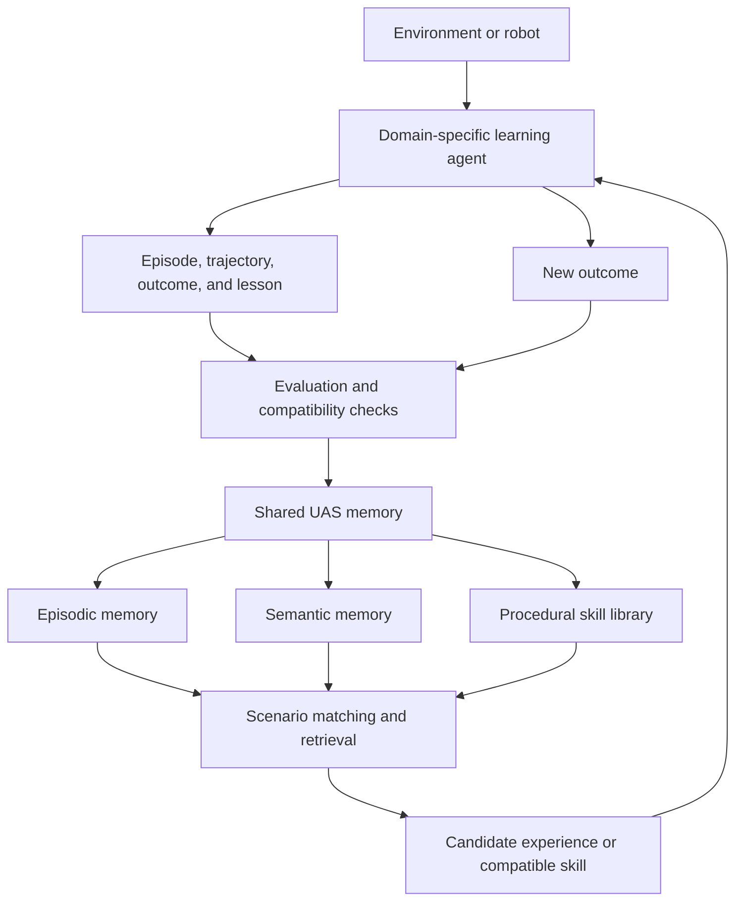

# How Existing Research Fits UAS

The Universe Agent System (UAS) combines ideas from several established research areas. Existing work supports many of its individual components, but it does not establish that the complete UAS architecture will improve learning. That remains a hypothesis to test experimentally.

This page maps the most relevant research to the role it could play in UAS. For the larger source list, see the [research landscape](RESEARCH_LANDSCAPE.md).

## Research-to-architecture map

| UAS function | Relevant research | What it contributes to UAS |
| --- | --- | --- |
| Agents operating across different worlds | [Gato](https://deepmind.google/blog/a-generalist-agent/), [SIMA 2](https://deepmind.google/blog/sima-2-an-agent-that-plays-reasons-and-learns-with-you-in-virtual-3d-worlds/), [XLand](https://deepmind.google/blog/generally-capable-agents-emerge-from-open-ended-play/), and [AdA](https://arxiv.org/abs/2301.07608) | Evidence that agents can learn across task distributions and adapt to held-out tasks within defined limits. |
| Distributed agents and central learning | [IMPALA](https://arxiv.org/abs/1802.01561) and [Distral](https://arxiv.org/abs/1707.04175) | Patterns for separating environment actors from central learning and for sharing useful behavior across task-specific workers. |
| Selective experience sharing | [Shared Experience Actor-Critic](https://arxiv.org/abs/2006.07169) and [Parallel Knowledge Transfer](https://arxiv.org/abs/2003.13085) | Evidence that one agent's experience can help another, while showing that transfer should be selective rather than automatic. |
| Episodic memory and reflection | [Generative Agents](https://arxiv.org/abs/2304.03442) and [Reflexion](https://arxiv.org/abs/2303.11366) | Patterns for recording events, retrieving relevant attempts, and converting outcomes into reusable lessons. |
| Structured long-term memory | [MemGPT](https://arxiv.org/abs/2310.08560), [A-MEM](https://arxiv.org/abs/2502.12110), and [HippoRAG](https://arxiv.org/abs/2405.14831) | Memory tiers, structured attributes, dynamic links, and associative retrieval rather than an unorganized collection of logs. |
| Reusable procedural skills | [Voyager](https://arxiv.org/abs/2305.16291) | A strong example of storing executable, compositional skills and retrieving them for new tasks. |
| Continual learning and evaluation | [CORA](https://proceedings.mlr.press/v199/powers22b.html), [Continual-Dreamer](https://proceedings.mlr.press/v232/kessler23a.html), and [MEAL](https://proceedings.mlr.press/v306/tomilin26a.html) | Methods and metrics for measuring forward transfer, backward transfer, forgetting, generalization, and learning efficiency. |
| Task and environment generation | [POET](https://arxiv.org/abs/1901.01753), [PAIRED](https://arxiv.org/abs/2012.02096), and XLand | Methods for generating challenges near an agent's learning frontier and transferring solutions between environments. |
| Predictive models and planning | [DreamerV3](https://arxiv.org/abs/2301.04104) | A model-based approach in which an agent learns environment dynamics and tests possible behavior using imagined futures. |
| Movement learning | [DeepMimic](https://arxiv.org/abs/1804.02717) and [Adversarial Motion Priors](https://arxiv.org/abs/2104.02180) | Techniques for turning demonstrations into robust, reusable physics-based movement. |
| Cross-robot learning | [RoboCat](https://deepmind.google/blog/robocat-a-self-improving-robotic-agent) and [Open X-Embodiment / RT-X](https://robotics-transformer-x.github.io/) | Evidence that data gathered from multiple tasks and robot embodiments can sometimes produce positive transfer. |
| Simulation-to-reality transfer | [Domain Randomization](https://arxiv.org/abs/1703.06907) and [Dactyl](https://openai.com/index/learning-dexterity/) | Techniques for reducing the gap between simulation and physical hardware, with task-specific validation still required. |
| Environment interfaces and benchmarks | [Gymnasium](https://gymnasium.farama.org/), [PettingZoo](https://pettingzoo.farama.org/), and [RLlib](https://docs.ray.io/en/latest/rllib/multi-agent-envs.html) | Standard interfaces through which UAS can collect episodes and connect to learning agents. They do not make different observation spaces, action spaces, or skills automatically compatible. |

## The proposed UAS loop

The central intelligence is the system around the memory, not the database alone. Its responsibilities include:

- interpreting the current task and situation;
- retrieving related experiences, knowledge, and skills;
- checking whether retrieved material is compatible with the agent and environment;
- ranking candidates using prior outcomes and confidence;
- evaluating the result after reuse;
- consolidating repeated observations into more general knowledge; and
- updating, distrusting, or forgetting material when evidence changes.

## Memory types

UAS should distinguish at least four kinds of memory:

| Memory type | Contents | Example |
| --- | --- | --- |
| Episodic | A particular attempt and its outcome | The agent collided while carrying a wide object through a doorway. |
| Semantic | Stable facts or relationships inferred across attempts | Wide objects require more clearance. |
| Procedural | An executable policy, plan, tool, or skill | A low-speed doorway traversal controller. |
| Working | Information needed for the current decision | Current goal, object width, doorway width, and recent actions. |

Each stored item should include provenance, environment and task identifiers, outcome, confidence, version, and compatibility constraints. Similarity alone is not sufficient evidence that a memory is useful or safe.

## What prior work already establishes

The cited research provides evidence that:

- experience from related tasks can sometimes improve learning and generalization;
- external memory and reflection can improve later decisions;
- procedural skills can be saved, retrieved, and composed;
- learning across sequences of tasks creates measurable transfer and forgetting effects;
- training across robot tasks and embodiments can produce positive transfer under controlled conditions; and
- generated environments and curricula can expose agents to increasingly useful challenges.

## What UAS still needs to establish

Prior work does **not** yet prove that:

- one central memory will help agents across unrelated domains;
- a skill learned with one observation or action space can execute in another;
- vector similarity is enough to select a useful skill;
- centralization is always better than local or distributed memory;
- simulation knowledge will transfer automatically to physical hardware; or
- adding more agents and memories will outperform a strong single-agent baseline.

These are research questions rather than current project capabilities.

## A focused first experiment

A small continuous, non-grid environment can test the central UAS hypothesis without requiring expensive hardware. Several tasks should share the same observation and action spaces, for example:

1. Navigate around obstacles.
2. Push an object to a target.
3. Carry an object through a narrow passage.
4. Recover after dropping or misplacing the object.
5. Complete a held-out task that combines navigation, carrying, and recovery.

The experiment should compare:

1. an independent agent with no shared memory;
2. an agent receiving every previous trajectory through naive shared replay;
3. an agent retrieving episodes by embedding similarity;
4. an agent using structured memory with provenance, outcome scores, deduplication, and compatibility filtering; and
5. an agent using both structured episodic memory and a library of validated skills.

Report task success, training steps, forward transfer, forgetting, retrieval cost, and negative-transfer cases over multiple random seeds. The important result is whether governed memory improves adaptation to the held-out task compared with the baselines.

## Potential UAS contribution

Most related projects focus on one part of the problem, such as a generalist policy, episodic retrieval, a skill library, continual learning, environment generation, or cross-robot data. A defensible UAS contribution would be the controlled integration and evaluation of these ideas:

> A governed shared memory through which multiple learning agents contribute validated experiences and reusable skills, while provenance and compatibility controls determine what knowledge can help an agent facing a related unfamiliar task.

This is the project's research position. It should be presented as a testable hypothesis until supported by reproducible experiments.
